<div align="center">

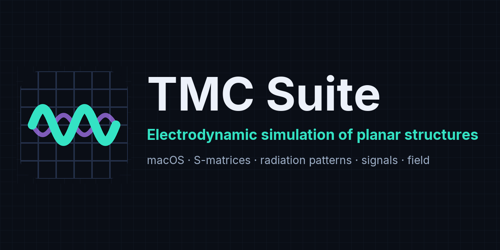

# TMC Suite for macOS

**Scientific software package for electrodynamic simulation of planar structures**

C++ · Qt 6 · Metal · macOS 13+ (Apple Silicon and Intel)

**English** · [Русский](#tmc-suite-для-macos-русская-версия)

</div>

---

## Overview

**TMC Suite** is an authorial scientific software package by **K. N. Klimov** for electrodynamic
computation and visualization of planar structures (H-polarization and X-mode). It computes
scattering matrices, radiation (directional) patterns, time-domain signals and electromagnetic
fields, and provides interactive viewers to explore the results.

This repository is the **macOS edition**: **7 programs** and **6 libraries**, packaged as `.app`
bundles. One image works on Apple Silicon and on Intel. Version 2.0 corresponds to the Windows edition
5.0 and the Linux edition 2.0: the same windows, menus and toolbars, the same computational code. File
formats are compatible: a task calculated on Windows opens here, and a result calculated here opens on
Windows.

## Components

### Computational kernels
| Program | Bundle | Purpose |
|---|---|---|
| **PlanarRT_H** | `PlanarRT_H.app` | Time-domain Rt-network solver, H-polarization |
| **PlanarRT_X** | `PlanarRT_X.app` | Time-domain Rt-network solver, X-mode (incl. magnetized plasma) |

### Viewers & tools
| Program | Bundle | Purpose |
|---|---|---|
| **TMCGROUT** | `TMCGROUT.app` | Scattering-matrix plots |
| **TMC_DN** | `TMC_DN.app` | Radiation (directional) patterns |
| **TMCROS** | `TMCROS.app` | Time-domain signals |
| **FieldView** | `FieldView.app` | Interactive visualization of electromagnetic fields (Qt RHI, Metal) |
| **TPL Designer** | `TplDesigner.app` | Visual editor of `.tpl` tasks, import of STEP, STL and OBJ models |

### Libraries
`SFILE95` · `complex` · `exprint` · `TMCLibError` · `PREPR` · `TMCIndan`

## Screenshots

| Field visualization (FieldView) | Task editor (TPL Designer) |
|---|---|
| 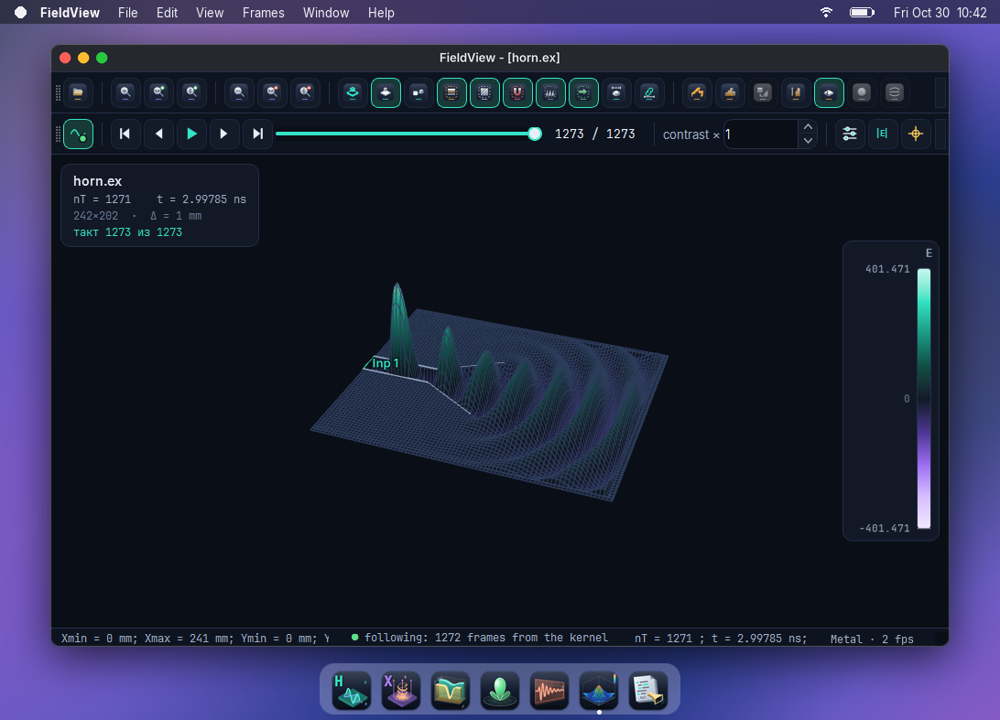 | 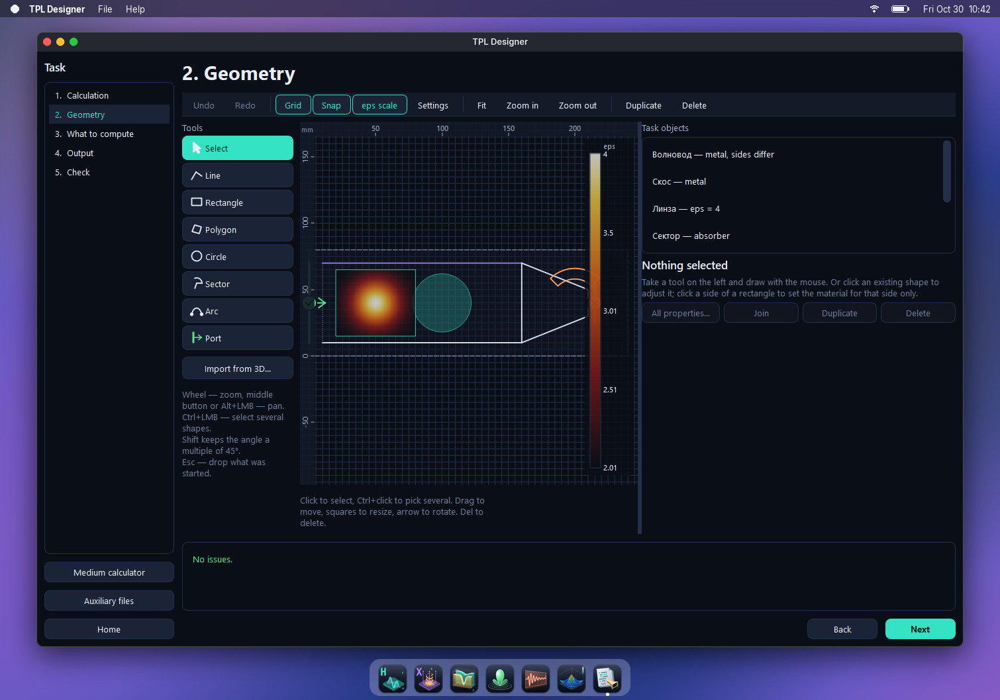 |

| Scattering matrix (TMCGROUT) | Radiation pattern (TMC_DN) |
|---|---|
| 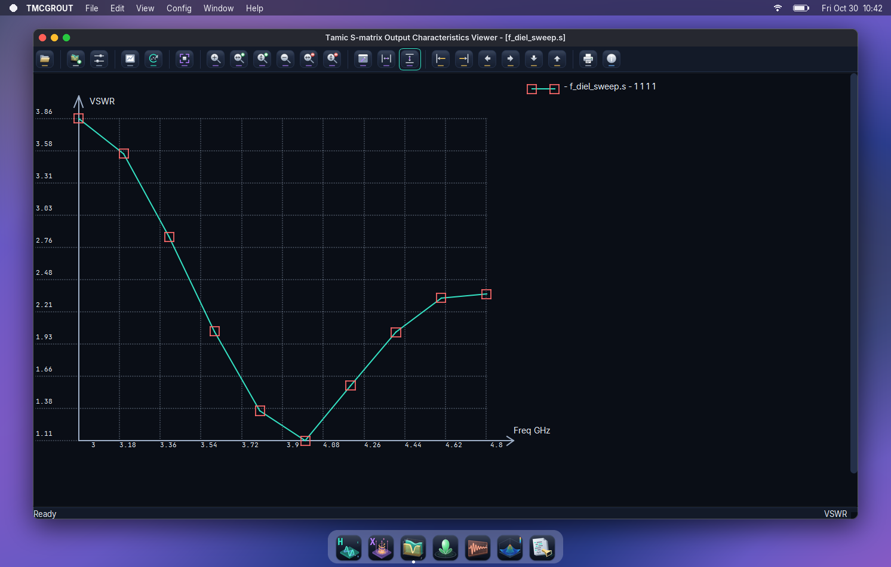 | 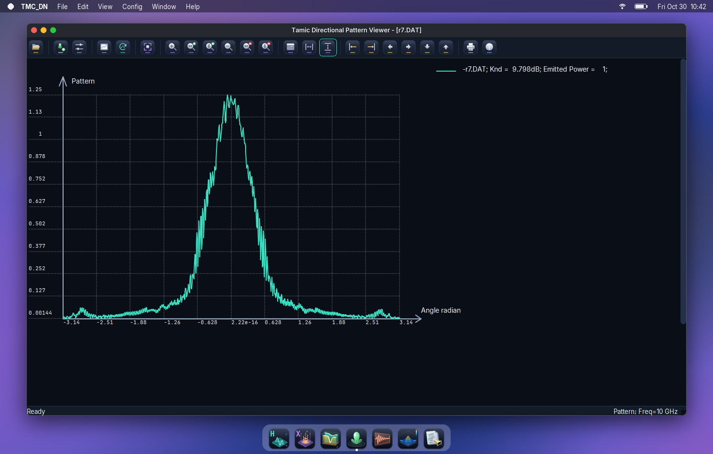 |

| Signals (TMCROS) | Solver at work (PlanarRT_H) |
|---|---|
| 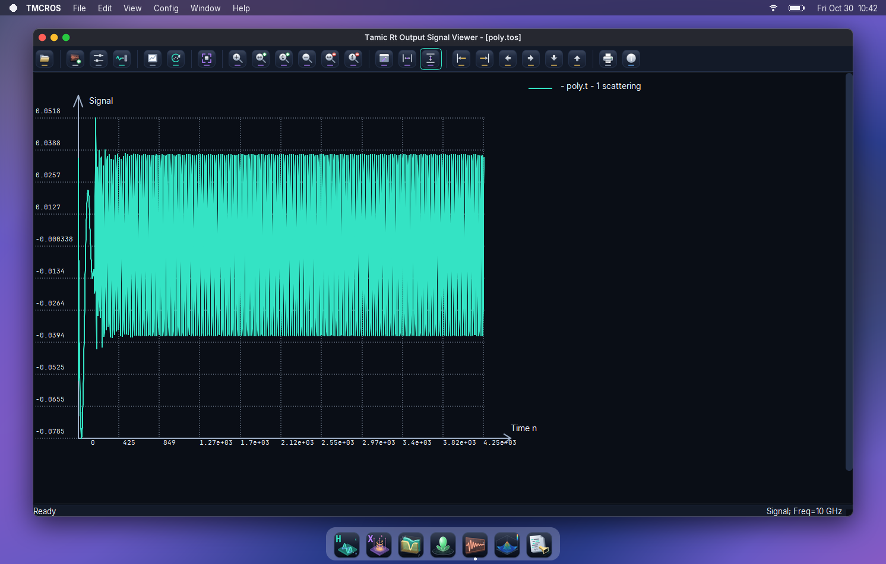 | 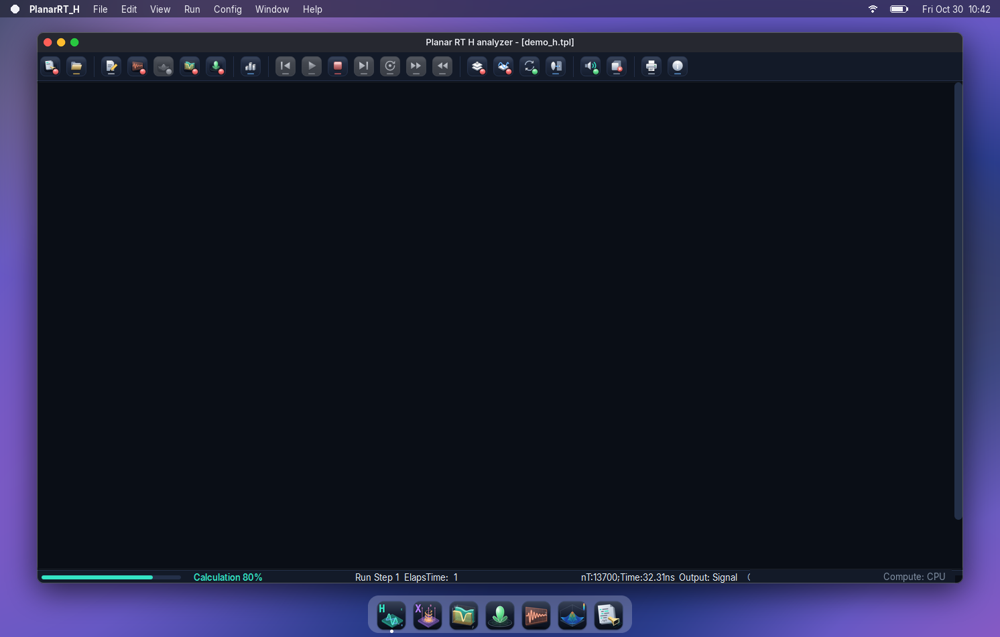 |

The screenshots show the windows of the Windows edition in a macOS frame, the terminal shows the kernel output of the
other editions: the windows and the output are the same.

## Installation

> **Release 2.0.0 has not been run on a real Mac yet.** It is built with a cross toolchain: the build,
> the bundles, the signature and the image are checked, the programs are not. See [Issues](../../issues).

Both files are in [Releases](../../releases). macOS 13 Ventura or newer, Apple Silicon or Intel, about
1.5 GB of disk space. Each file contains all seven programs, sample tasks and the user manual in
Russian and English. Qt 6 and OpenCASCADE are inside the bundles, nothing else has to be installed.

| File | Purpose |
|---|---|
| `TMC_Suite-2.0.0-macos-universal.dmg` | Disk image: open it and drag the programs into **Applications** |
| `TMC_Suite-2.0.0-macos-universal.zip` | The same contents as an archive, in case the image does not open |

1. Open the `.dmg` file and drag the seven programs into **Applications**. Copy the manual and the
   `Samples` folder wherever is convenient.
2. The bundles are **not signed with Apple**, so the first launch has to be allowed. Open **System
   Settings → Privacy & Security** and click **Open Anyway**, or run in Terminal:

   ```sh
   xattr -dr com.apple.quarantine /Applications/TMCROS.app /Applications/TMCGROUT.app \
       /Applications/TMC_DN.app /Applications/PlanarRT_H.app /Applications/PlanarRT_X.app \
       /Applications/FieldView.app /Applications/TplDesigner.app
   ```

3. On the first access to **Desktop**, **Documents** or **Downloads** macOS asks for permission.
   Until the question is answered, the program waits.

A double click in Finder opens files in the right program: `.tpl` in PlanarRT_H, `.s` and `.soc` in
TMCGROUT, `.t`, `.tos` and `.toc` in TMCROS, `.dop` in TMC_DN, field files in FieldView. Step by step:
[installation guide](https://www.tamic.ru/docs/install/macos.html).

## Running a calculation from the terminal

The kernels calculate a task without user actions and report to the terminal. The executable file is
inside the bundle. Give the full path to the task: its folder is where the included files are looked
for and the results are written.

```sh
/Applications/PlanarRT_H.app/Contents/MacOS/PlanarRT_H ~/calc/horn.tpl -Arb -Time
echo $?
```

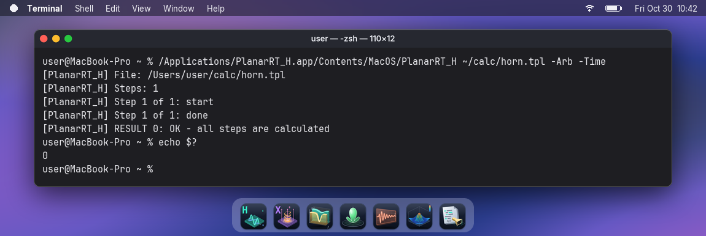

| Key | What it does |
|---|---|
| `-Arb` | calculate all steps and always close the window at the end |
| `-Ar` | calculate all steps; after an error the window stays open |
| `-Time` | write the calculation time report next to the task |
| `-GPU`, `-GPU:n` | calculate on the video card, or on card number `n` (from 0) |
| `-CPU` | calculate on the processor, even if the video card is switched on in the settings |

| Exit code | Meaning |
|---|---|
| 0 | all steps are calculated |
| 1 | error in the task |
| 2 | error during the calculation (the sweep is calculated to the end) |
| 3 | the calculation was stopped |

`PlanarRT_X` works in the same way.

## Video card

The GPU path of the Windows and Linux editions is included: OpenCL 1.2 with double precision. OpenCL
is part of macOS, so nothing has to be installed. The calculation is **double precision only**, and
what is possible depends on the Mac:

| Mac | Where the calculation runs |
|---|---|
| Apple Silicon (M1 and newer) | **On the processor.** OpenCL on Apple graphics has no double precision (`cl_khr_fp64`) |
| Intel with an AMD Radeon card | On the video card, if the Apple driver declares `cl_khr_fp64` and the card passes the bit-exact self-test |
| Intel with integrated graphics | On the processor: no double precision |

| Item | Details |
|---|---|
| How to switch on | **Config → Compute (GPU)**: the window lists the cards, runs the self-test or tells why the calculation stays on the processor |
| From the terminal | keys `-GPU`, `-GPU:n`, `-CPU` |
| Memory on the card | about 32 bytes per node for H and 96 bytes per node for X |
| Stays on the processor | small grids (below 150 thousand nodes for H, 60 thousand for X; `TMC_GPU_MIN_NODES` changes it), and grids that do not fit into the card's memory; the time report gives the reason |

The numbers do not change: on Windows and Linux the card gives the same results as the processor, bit
for bit. Version 2.0.0 has not been run on a real video card under macOS yet.
More: [video card on macOS](https://www.tamic.ru/docs/platforms/macos.html#gpu),
[manual chapter](https://www.tamic.ru/docs/user-manual/gpu.html).

## Input format

The kernels read `.tpl` task files. The language is described on the website:
[`.tpl` language guide](https://www.tamic.ru/docs/user-manual/tpl-guide.html). TPL Designer writes the same
files without manual typing.

## What's new in 2.0

- **Interface of the Windows edition 5.0**: dark theme, the same toolbars, Russian and English languages.
- **Icons for macOS**: `.icns` on the Apple grid with every size up to 1024 points drawn from the vector
  source, toolbars drawn at double resolution on Retina displays.
- **All fixes of the kernels and programs** of the Windows edition, multi-frequency calculation,
  radiation patterns over the border, grids above 2³¹ nodes.
- **TPL Designer** is now built with the package, **FieldView** draws through Metal.
- **Code refactoring**: 431 code files instead of 555, Windows, Linux and DOS branches and dead code
  removed, everything documented with links to the website, a build without errors and warnings.
- **Apache License 2.0** instead of the previous academic license.

## Building

On a Mac: Xcode tools, CMake, Ninja, Qt 6.11 with the Qt Shader Tools module, OpenCASCADE.

```sh
xcode-select --install
brew install cmake ninja opencascade
OCCT_DIR=$(brew --prefix opencascade)/lib/cmake/opencascade TMC_ARCHS=arm64 build/build_macos.sh
```

Qt goes to `~/Qt` from [qt.io](https://www.qt.io/download-open-source); another path is set by the `QT`
variable. Bundles appear in `dist/macos`. With a universal OpenCASCADE, leave out `TMC_ARCHS` and the
files hold both architectures. The release is built on Linux with osxcross: `build/build_macos.sh --cross`.
Build order: [`BUILD_ORDER.md`](BUILD_ORDER.md); step by step:
[build guide](https://www.tamic.ru/docs/platforms/macos.html#build).

## Other systems

| Repository | What it is |
|---|---|
| **this repository** | macOS, universal build for Apple Silicon and Intel |
| [TMC Suite](https://github.com/klimov-kn/TMC_Suite) | Windows, Qt 6, 64 bits |
| [TMC Suite for Linux (graphical)](https://github.com/klimov-kn/TMC_Suite_Linux_GUI) | Linux, all programs on Qt 6 |
| [TMC Suite for Linux (console)](https://github.com/klimov-kn/TMC_Suite_Linux_Console) | Linux, computation kernels without windows |

## Documentation

Documentation in Russian and English — user manuals, the `.tpl` language reference, the code
reference and the build guide — is published on the project website
[www.tamic.ru](https://www.tamic.ru). Comments in the source code link to the corresponding pages.
This edition: [macOS](https://www.tamic.ru/docs/platforms/macos.html).

Defects and questions: [Issues](../../issues).

## Author & links

- **Author:** K. N. Klimov
- **Website:** [www.tamic.ru](https://www.tamic.ru)

## License

[Apache License 2.0](LICENSE). See also [`NOTICE`](NOTICE).

---

<div align="center">

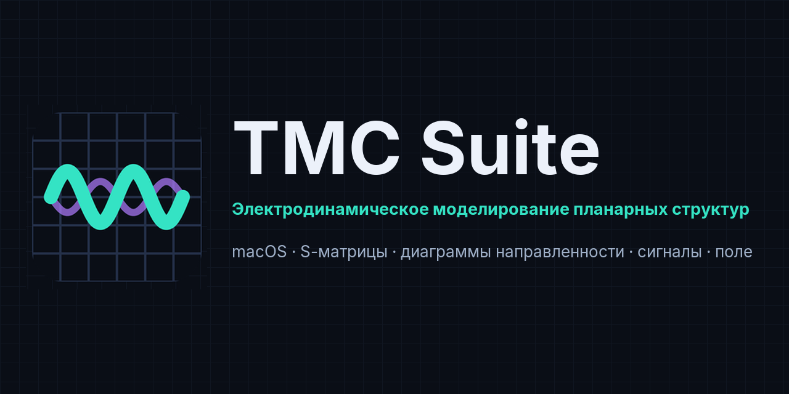

# TMC Suite для macOS (русская версия)

**Научный пакет для электродинамического расчёта планарных структур**

C++ · Qt 6 · Metal · macOS 13+ (Apple Silicon и Intel)

[English](#tmc-suite-for-macos) · **Русский**

</div>

---

## О проекте

**TMC Suite** — авторский научный пакет **К. Н. Климова** для электродинамического расчёта и
визуализации планарных структур (H-поляризация и X-мода). Он вычисляет матрицы рассеяния, диаграммы
направленности, сигналы во времени и электромагнитные поля, а вьюверы позволяют изучать результаты.

Этот репозиторий — **версия для macOS**: **7 программ** и **6 библиотек**, пакеты `.app`. Один образ
работает и на Apple Silicon, и на Intel. Версия 2.0 соответствует Windows-версии 5.0 и версии для Linux
2.0: те же окна, меню и панели, тот же расчётный код. Форматы файлов совместимы: задание, посчитанное в
Windows, открывается здесь, а результат отсюда открывается в Windows.

## Состав

### Счётные ядра
| Программа | Пакет | Назначение |
|---|---|---|
| **PlanarRT_H** | `PlanarRT_H.app` | Расчёт Rt-сетями во временной области, H-поляризация |
| **PlanarRT_X** | `PlanarRT_X.app` | Расчёт Rt-сетями во временной области, X-мода (в том числе подмагниченная плазма) |

### Вьюверы и средства
| Программа | Пакет | Назначение |
|---|---|---|
| **TMCGROUT** | `TMCGROUT.app` | Графики матриц рассеяния |
| **TMC_DN** | `TMC_DN.app` | Диаграммы направленности |
| **TMCROS** | `TMCROS.app` | Сигналы во времени |
| **FieldView** | `FieldView.app` | Просмотр электромагнитных полей (Qt RHI, Metal) |
| **TPL Designer** | `TplDesigner.app` | Визуальный редактор заданий `.tpl`, импорт моделей STEP, STL и OBJ |

### Библиотеки
`SFILE95` · `complex` · `exprint` · `TMCLibError` · `PREPR` · `TMCIndan`

## Скриншоты

| Просмотр поля (FieldView) | Редактор заданий (TPL Designer) |
|---|---|
| 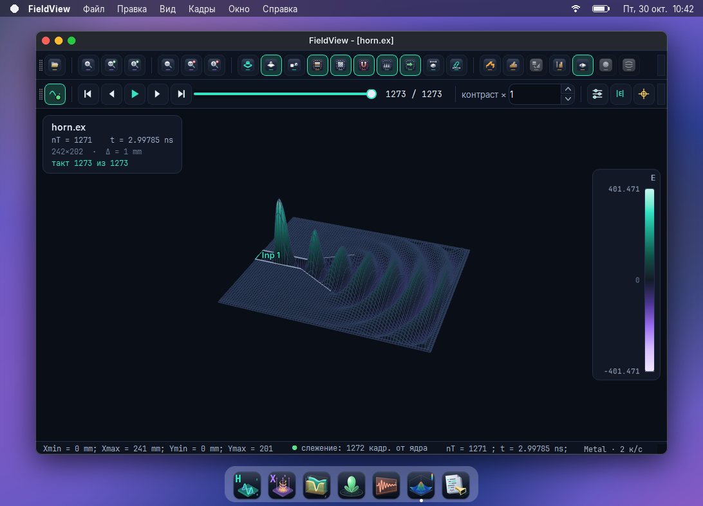 | 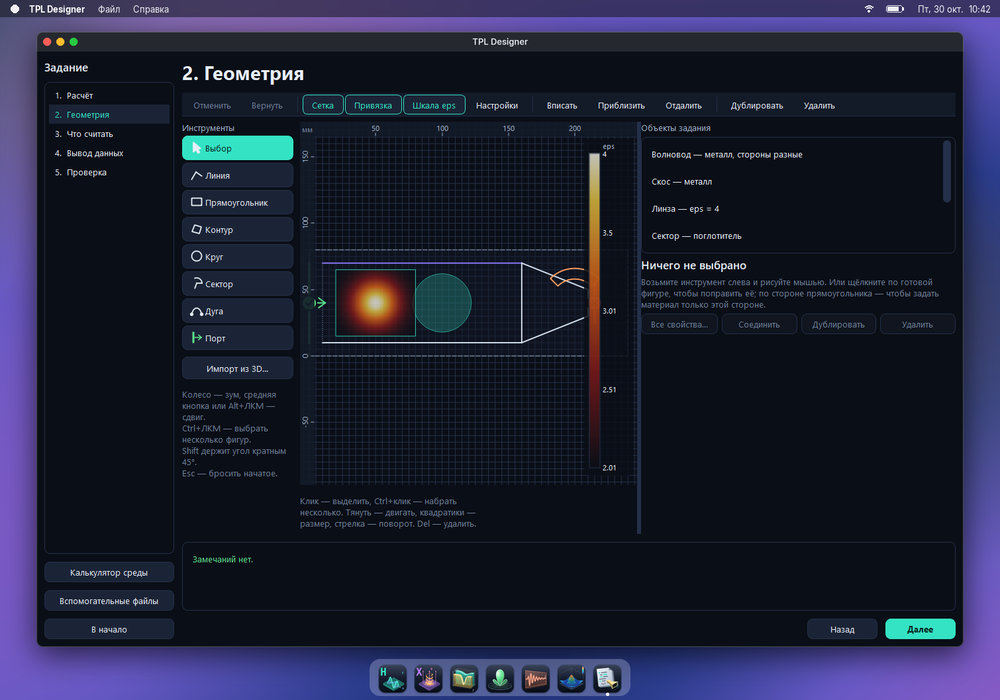 |

| Матрица рассеяния (TMCGROUT) | Диаграмма направленности (TMC_DN) |
|---|---|
|  | 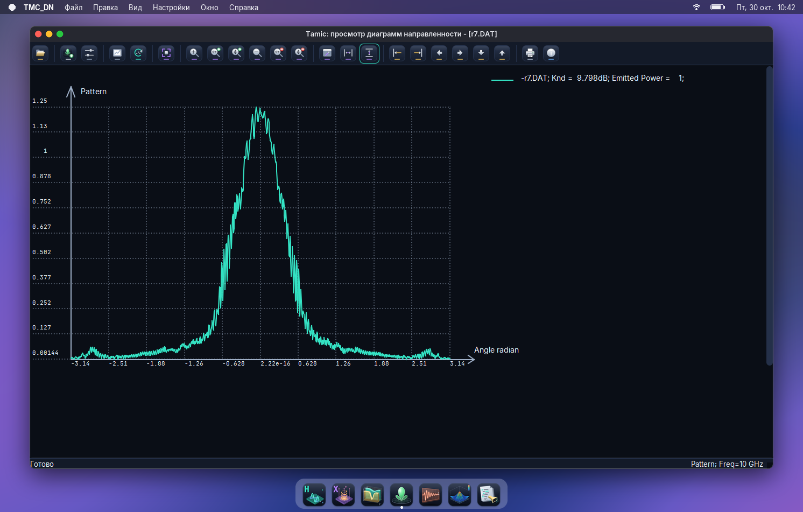 |

| Сигналы (TMCROS) | Ядро за работой (PlanarRT_H) |
|---|---|
|  | 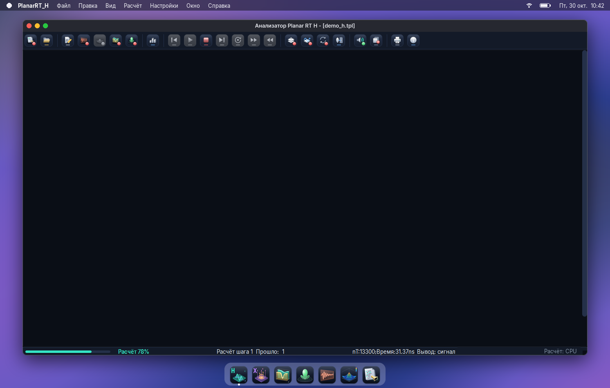 |

На снимках окна Windows-версии в рамке macOS, в терминале вывод ядра других версий: окна и вывод те же.

## Установка

> **Выпуск 2.0.0 пока не запускался на настоящем маке.** Он собран кросс-набором: проверены сборка,
> пакеты, подпись и образ, но не работа программ. См. [Issues](../../issues).

Оба файла — в [Releases](../../releases). Нужны macOS 13 Ventura или новее, Apple Silicon или Intel,
около 1,5 ГБ на диске. В каждом файле все семь программ, образцы заданий и руководство пользователя на
русском и английском. Qt 6 и OpenCASCADE лежат внутри пакетов, больше ничего ставить не нужно.

| Файл | Для чего |
|---|---|
| `TMC_Suite-2.0.0-macos-universal.dmg` | Образ: открыть и перетащить программы в **Программы** |
| `TMC_Suite-2.0.0-macos-universal.zip` | Тот же состав архивом, если образ не открывается |

1. Откройте `.dmg` и перетащите семь программ в **Программы**. Руководство и папку `Samples`
   скопируйте туда, где удобно.
2. Пакеты **не подписаны у Apple**, поэтому первый запуск нужно разрешить. Откройте **Системные
   настройки → Конфиденциальность и безопасность** и нажмите **Всё равно открыть** либо выполните в
   Терминале:

   ```sh
   xattr -dr com.apple.quarantine /Applications/TMCROS.app /Applications/TMCGROUT.app \
       /Applications/TMC_DN.app /Applications/PlanarRT_H.app /Applications/PlanarRT_X.app \
       /Applications/FieldView.app /Applications/TplDesigner.app
   ```

3. При первом обращении к папкам **Рабочий стол**, **Документы** или **Загрузки** macOS спрашивает
   разрешение. Пока на вопрос не ответили, программа ждёт.

Двойной щелчок в Finder открывает файл в нужной программе: `.tpl` в PlanarRT_H, `.s` и `.soc` в TMCGROUT,
`.t`, `.tos` и `.toc` в TMCROS, `.dop` в TMC_DN, файлы поля в FieldView. Подробно:
[инструкция по установке](https://www.tamic.ru/docs/install/macos.html).

## Запуск расчёта из терминала

Ядра считают задание без участия пользователя и сообщают о ходе расчёта в терминал. Исполняемый файл
лежит внутри пакета. Указывайте полный путь к заданию: в его папке ищутся подключаемые файлы и пишутся
результаты.

```sh
/Applications/PlanarRT_H.app/Contents/MacOS/PlanarRT_H ~/calc/horn.tpl -Arb -Time
echo $?
```

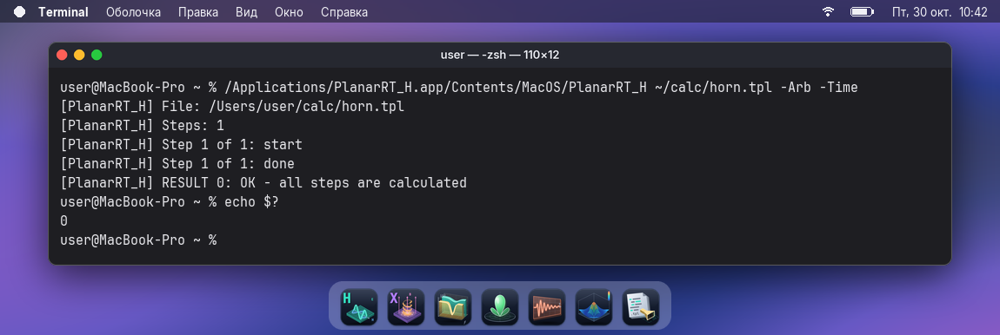

| Ключ | Что делает |
|---|---|
| `-Arb` | посчитать все шаги и всегда закрыть окно в конце |
| `-Ar` | посчитать все шаги; после ошибки окно остаётся открытым |
| `-Time` | записать отчёт о времени расчёта рядом с заданием |
| `-GPU`, `-GPU:n` | считать на видеокарте или на карте с номером `n` (с 0) |
| `-CPU` | считать на процессоре, даже если видеокарта включена в настройках |

| Код завершения | Значение |
|---|---|
| 0 | все шаги посчитаны |
| 1 | ошибка в задании |
| 2 | ошибка при расчёте (свип считается до конца) |
| 3 | расчёт остановлен |

`PlanarRT_X` работает так же.

## Видеокарта

В версию входит тот же путь расчёта на видеокарте, что в версиях для Windows и Linux: OpenCL 1.2 с
двойной точностью. OpenCL входит в macOS, ставить ничего не нужно. Расчёт идёт **только с двойной
точностью**, поэтому возможности зависят от компьютера:

| Компьютер | Где идёт расчёт |
|---|---|
| Apple Silicon (M1 и новее) | **На процессоре.** OpenCL видеокарты Apple не поддерживает двойную точность (`cl_khr_fp64`) |
| Intel с видеокартой AMD Radeon | На видеокарте, если драйвер Apple объявляет `cl_khr_fp64` и карта проходит побитный самотест |
| Intel со встроенной графикой | На процессоре: двойной точности нет |

| Что | Подробности |
|---|---|
| Как включить | **Настройки → Вычисления**: окно показывает карты, запускает самотест или называет причину, по которой расчёт остаётся на процессоре |
| Из терминала | ключи `-GPU`, `-GPU:n`, `-CPU` |
| Память карты | около 32 байт на узел для H и 96 байт для X |
| Остаётся на процессоре | небольшие сетки (менее 150 тысяч узлов для H, 60 тысяч для X; меняется переменной `TMC_GPU_MIN_NODES`) и сетки, не помещающиеся в память карты; причину называет отчёт о времени |

Числа не меняются: в Windows и Linux карта даёт те же результаты, что процессор, бит в бит. На
настоящей видеокарте под macOS версия 2.0.0 пока не проверялась.
Подробно: [видеокарта на macOS](https://www.tamic.ru/docs/platforms/macos.html#gpu),
[глава руководства](https://www.tamic.ru/docs/user-manual/gpu.html).

## Формат входных данных

Ядра читают файлы заданий `.tpl`. Язык описан на сайте:
[справочник языка `.tpl`](https://www.tamic.ru/docs/user-manual/tpl-guide.html). TPL Designer пишет те же
файлы без ручного набора.

## Что нового в версии 2.0

- **Интерфейс Windows-версии 5.0**: тёмная тема, те же панели, русский и английский языки.
- **Значки для macOS**: `.icns` по сетке Apple, каждый размер до 1024 точек нарисован из вектора, панели
  на экранах Retina рисуются в двойном разрешении.
- **Все исправления ядер и программ** Windows-версии, многочастотный расчёт, диаграммы направленности по
  границе, сетки больше 2³¹ узлов.
- **TPL Designer** собирается вместе с пакетом, **FieldView** рисует через Metal.
- **Рефакторинг кода**: 431 файлов кода вместо 555, удалены ветки Windows, Linux и DOS и мёртвый код,
  всё описано со ссылками на сайт, сборка без ошибок и предупреждений.
- **Лицензия Apache 2.0** вместо прежней академической.

## Сборка

На маке нужны инструменты Xcode, CMake, Ninja, Qt 6.11 с модулем Qt Shader Tools и OpenCASCADE.

```sh
xcode-select --install
brew install cmake ninja opencascade
OCCT_DIR=$(brew --prefix opencascade)/lib/cmake/opencascade TMC_ARCHS=arm64 build/build_macos.sh
```

Qt ставится в `~/Qt` с [qt.io](https://www.qt.io/download-open-source); другой путь задаёт переменная `QT`.
Пакеты появятся в `dist/macos`. С универсальной сборкой OpenCASCADE `TMC_ARCHS` не нужна: файлы будут для
обеих архитектур. Выпуск собирается на Linux кросс-набором osxcross: `build/build_macos.sh --cross`.
Порядок сборки: [`BUILD_ORDER.md`](BUILD_ORDER.md); подробно:
[инструкция по сборке](https://www.tamic.ru/docs/platforms/macos.html#build).

## Другие системы

| Репозиторий | Что это |
|---|---|
| **этот репозиторий** | macOS, универсальная сборка для Apple Silicon и Intel |
| [TMC Suite](https://github.com/klimov-kn/TMC_Suite) | Windows, Qt 6, 64 бита |
| [TMC Suite для Linux (графическая)](https://github.com/klimov-kn/TMC_Suite_Linux_GUI) | Linux, все программы на Qt 6 |
| [TMC Suite для Linux (консольная)](https://github.com/klimov-kn/TMC_Suite_Linux_Console) | Linux, счётные ядра без окон |

## Документация

Документация на русском и английском — руководства, справочник языка `.tpl`, описание кода и инструкция
по сборке — опубликована на сайте проекта [www.tamic.ru](https://www.tamic.ru). Комментарии в исходном коде
ссылаются на соответствующие страницы. Эта версия: [macOS](https://www.tamic.ru/docs/platforms/macos.html).

Дефекты и вопросы: [Issues](../../issues).

## Автор и ссылки

- **Автор:** К. Н. Климов
- **Сайт:** [www.tamic.ru](https://www.tamic.ru)

## Лицензия

[Apache License 2.0](LICENSE). См. также [`NOTICE`](NOTICE).
